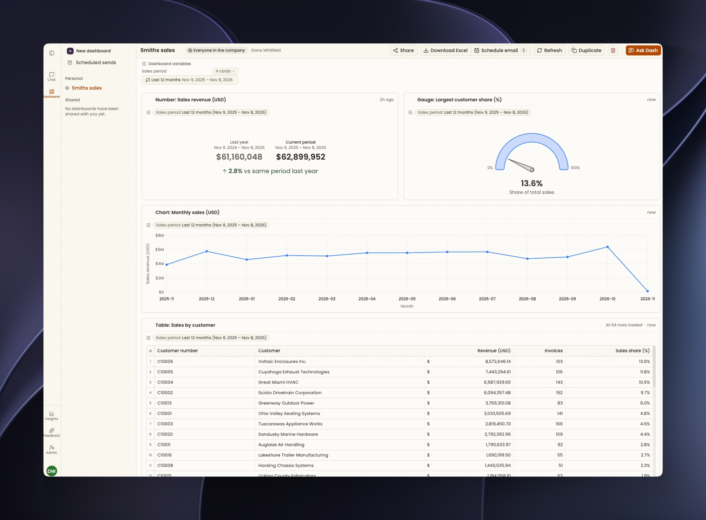

Keep your dashboard useful as your questions change. Ask Dash for the information you need, explore the results, and organize the dashboards you return to. To create your first one, follow the [Dashboard quickstart](/dashboards/quickstart).

## Ask Dash to build or change your dashboard

Open a dashboard you own and click **Ask Dash**. Describe what you want to add, change, or remove. Dash uses the dashboard and its current variables as context.

For example, on a sales dashboard:

<Prompt description="Add a breakdown of sales by customer to this dashboard. Keep the current reporting period.">
  Add a breakdown of sales by customer to this dashboard. Keep the current reporting period.
</Prompt>

## Review and approve changes

Dash shows a preview and a list of the changes it proposes. Check the information, labels, and time periods before saving.

| What you want to do | Action |
| --- | --- |
| Save the proposed changes | Click **Approve all**. |
| Adjust the proposal | Tell Dash what should change, then review its updated proposal. |
| Keep the saved dashboard as it is | Click **Discard**. |

If you close the Dash panel while a proposal is pending, click **Review** in the dashboard's pending-change notice to return to it.

<Frame caption="Review Dash's proposed change, ask for a revision, then approve it.">
  <video autoPlay muted loop playsInline src="/assets/clips/dashboard_edit.mp4" />
</Frame>

Changes requested through Dash wait for approval. Direct presentation changes, such as changing a chart's color in its menu, save immediately when you have editing access. Some menus are unavailable while a proposal is pending.

## Available cards and visualizations

Dash chooses visualizations to suit the information you request. You can also ask for a particular format, such as “Show that as a table” or “Use a line chart for the monthly trend.”

<Columns cols={2}>
  <Card title="Tables" icon="table" href="/dashboards/cards/tables">
    Explore records, highlight exceptions, and compare grouped results with a pivot.
  </Card>
  <Card title="Charts" icon="chart-column" href="/dashboards/cards/charts">
    View trends with lines, compare categories with bars, or see shares with pie and donut charts.
  </Card>
  <Card title="Numbers" icon="hashtag" href="/dashboards/cards/numbers-and-gauges#track-a-key-metric">
    Follow a key measure and compare it with an earlier period or a target.
  </Card>
  <Card title="Gauges" icon="gauge" href="/dashboards/cards/numbers-and-gauges#show-performance-against-a-range">
    See where a measure falls within a range of colored zones.
  </Card>
</Columns>

<Frame caption="One dashboard with all four card types: a number, a gauge, a chart, and a table.">
  
</Frame>

## Explore a result with Dash

Ask Dash to explain a result or investigate a change. It can use the selected cards and current variables as context. On a shared dashboard, identify the card in your message.

For a chart, turn on **Data picker** to inspect values. Click a plotted point or pie/donut slice to prepare a question about it in Dash. Review the draft, then send it.

<Frame caption="Pick a chart point with Data picker, then send its prepared question to Dash.">
  <video autoPlay muted loop playsInline src="/assets/clips/dashboard_datapicker.mp4" />
</Frame>

To understand the steps behind a result, open **Show logic** in the card's header.

## Arrange and refresh your dashboard

On a dashboard you own, drag cards using their move handles and resize them to give important results more room. You can also ask Dash to arrange the dashboard for you.

<Frame caption="Drag a card by its move handle and resize it to give a result more room.">
  <video autoPlay muted loop playsInline src="/assets/clips/dashboard_draganddrop.mp4" />
</Frame>

Click **Refresh** in the dashboard header to update the dashboard using the data available to Galvant. Wait for it to finish and check for any errors before using the updated results.

## Find and manage saved dashboards

Open **Dashboards** to find **Personal** dashboards you own and **Shared** dashboards available to you. Your browser's pinned dashboards appear under **Pinned**.

<AccordionGroup>
  <Accordion title="Rename a dashboard">
    On a dashboard you own, click its title, enter a new name, and press **Enter**.

  </Accordion>
  <Accordion title="Pin a dashboard">
    Hover over a dashboard in the list and click its pin control. Click it again to unpin. Pins are stored in your browser.

    <Info>
      **GIF placeholder: DASH-09**

      Rename an owned dashboard, then pin it. Show the new title in the list and the dashboard appearing under Pinned.
    </Info>
  </Accordion>
  <Accordion title="Make your own copy">
    Use **Duplicate** on a dashboard you own or **Duplicate and edit** on a shared dashboard. The copy belongs to you, so you can adapt it independently.

  </Accordion>
  <Accordion title="Delete a dashboard">
    On a dashboard you own, click **Delete dashboard**, the trash button in the header, and review the confirmation.

    <Warning>
      Deleting permanently removes the dashboard, its cards, and its Dash conversation history. This cannot be undone.
    </Warning>

  </Accordion>
</AccordionGroup>

To let teammates use the same live dashboard, see [Share dashboards](/dashboards/sharing). To change a reporting period or another shared input, see [Use dashboard variables](/dashboards/variables).
